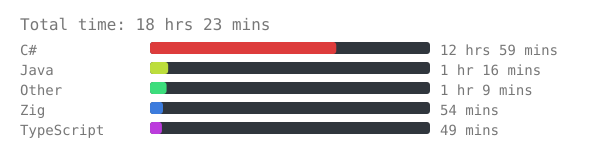
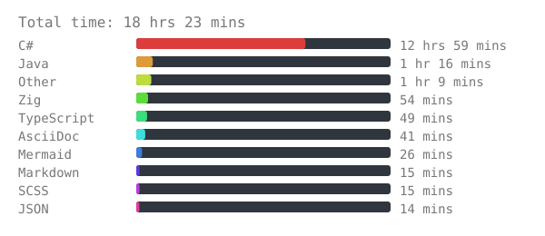
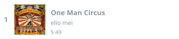
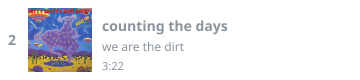
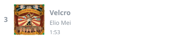
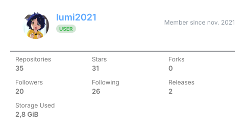
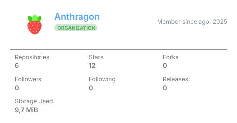
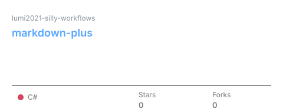
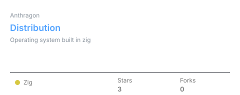

# MD+

A new way of enchanting your github overview

<!-- Unknown node ThematicBreakNode -->

MD+ (Markdown plus) is a github tool that provides extra resources for enchanting
someone's github overview profile.

Those resources includes:

- Third-party apps and services, such as shields.io badges
- Custom apps and widgets provided by MD+
- Dynamic profile components
- Automated content generation and updates
- Scheduled daily or weekly updates
- Integrations with external services (steam, wakatime, etc.)
- Customizable resources that can be embedded directly into your

GitHub profile README or any markdown file

This tool works by compiling a template written in an extended version of the
github's markdown + html language into a verbose and automated version of that
same template.

## Services

### Badges

Integration with [shields.io](https://shields.io/) made straight forward.

The `badge` tag is an inline tag that can be used to create static shields.io
badges inside the code:

```html
<badge color="202020" icon="python">python</badge>
<badge color="303030" style="flat" icon="c">C</badge>
<badge color="404040" style="flat-square" icon="c++">C++</badge>
<badge color="505050" style="plastic" icon="dotnet">C#</badge>
<badge color="606060" style="for-the-badge" icon="zig">Zig</badge>
<badge color="707070" style="social" icon="lua">Lua</badge>
<br/>
<badge color="282b30" style="for-the-badge" icon="discord" href="https://discordapp.com/users/632992487375634432">Discord</badge>
<badge color="ffffff" style="for-the-badge" icon="linkedin" labelColor="0077B5" href="https://www.linkedin.com/in/leoaraujodev">Linkedin</badge>
<badge color="000000" style="for-the-badge" icon="threads" href="https://www.threads.com/@42batata42">Threads</badge>
```


<br />

[](https://discordapp.com/users/632992487375634432)[](https://www.linkedin.com/in/leoaraujodev)[](https://www.threads.com/@42batata42)

The following attributes can be applied to a `badge` tag:

- `icon`: The icon shown in the tag. Icons provided by [Simple Icons](https://simpleicons.org/).
- `href`: Link to redirect when clicking in the badge.
- `style`: Badge style. Options are  [`flat`, `flat-square`, `plastic`, `for-the-badge`, `social`] (default is `flat`).
- `color`: The tag's background color.
- `icon-color`: The tag's icon color.
- `label-color`: The tag's label color.

### Typing

Integration with [readme-typing-svg](https://readme-typing-svg.herokuapp.com/demo/) made straight forward.

The `typing` tag is a block tag that can be used to create typing animations.

```html
<typing
      font="Rock Salt" size="20" duration="3000" pause="300"
      width="500" height="60" repeat="off"
>
Look at me!
I'm typing!
</typing>
```

<picture>
<source media="(prefers-color-scheme: dark)" srcset="https://readme-typing-svg.herokuapp.com?width=500&height=60&center=true&vCenter=true&multiline=true&repeat=false&lines=Look+at+me!%3BI%27m+typing!&color=cfcfcf" />
<source media="(prefers-color-scheme: light)" srcset="https://readme-typing-svg.herokuapp.com?width=500&height=60&center=true&vCenter=true&multiline=true&repeat=false&lines=Look+at+me!%3BI%27m+typing!&color=000000" />

</picture>

The `typing` tag only supports raw text content.

The following attributes can be applied to the `typing` tag:

- `font-family`: Rendered text's font family. Fonts provided by [Google Fonts](https://fonts.google.com/).
- `font-size`: Rendered text's font size.
- `font-weight`: Rendered text's font weight.
- `letter-spacing`: Rendered text's letter spacing.
- `char-duration`: Wait time between each character typing.
- `line-duration`: Wait time between each line typing.
- `width`: Rendered image's width, in pixels. Default is 400.
- `height`: Rendered image's height, in pixels. Default is 100.
- `repeat`: If `on`, the animation repeats. Default is `on`.

### Wakatime

Integrations with the [Wakatime](https://wakatime.com) service.

The `wakatime` block tag provides different information that can be
chosen though the `option` attribute.

For allowing this service to work, the tool needs the following
variables:

- `wakatime_api_key`: The API key provided by the wakatime service.

```html
<wakatime-weekly-langs />
<wakatime-weekly-langs max="10" />
<wakatime-weekly-langs style="display: code;" levels="⣿⣷⣶⣦⣤⣄⣀" />
```

<p align="center">

</p>

<p align="center">

</p>

```rust
Total Time: 18 hrs 23 mins

- "C#"            ⣿⣿⣿⣿⣿⣿⣿⣿⣿⣿⣿⣿⣿⣿⣿⣿⣿⣿⣿⣿⣀⣀⣀⣀⣀⣀⣀⣀⣀⣀ 12 hrs 59 mins
- "Java"          ⣿⣿⣀⣀⣀⣀⣀⣀⣀⣀⣀⣀⣀⣀⣀⣀⣀⣀⣀⣀⣀⣀⣀⣀⣀⣀⣀⣀⣀⣀ 1 hr 16 mins
- "Other"         ⣿⣷⣀⣀⣀⣀⣀⣀⣀⣀⣀⣀⣀⣀⣀⣀⣀⣀⣀⣀⣀⣀⣀⣀⣀⣀⣀⣀⣀⣀ 1 hr 9 mins
- "Zig"           ⣿⣤⣀⣀⣀⣀⣀⣀⣀⣀⣀⣀⣀⣀⣀⣀⣀⣀⣀⣀⣀⣀⣀⣀⣀⣀⣀⣀⣀⣀ 54 mins
- "TypeScript"    ⣿⣤⣀⣀⣀⣀⣀⣀⣀⣀⣀⣀⣀⣀⣀⣀⣀⣀⣀⣀⣀⣀⣀⣀⣀⣀⣀⣀⣀⣀ 49 mins
```

The following attributes can be applied to the `wakatime-weekly-langs` tag:

- `max`: Maximum number of listed languages (default is 5)
- `style`: CSS-based styling
- `levels`: Charset used for the bar when `style.display` is `code`

### Last.fm

Integrations with the [last.fm](https://www.last.fm/home) service.

The `last-fm` block tag provides the list of your mostly listened
songs, as tracked by last.fm.

For allowing this service to work, the tool needs the following
variables:

- `lastfm_api_key`: The API key provided by the last.fm service.
- `lastfm_username`: The username of the targeted last.fm profile.

```html
<last-fm-recent />
```

<div>
<a href="https://www.last.fm/music/Jamie+Paige/_/Machine+Love">
</img>
</a>
<a href="https://www.last.fm/music/elio+mei/_/One+Man+Circus">
</img>
</a>
<a href="https://www.last.fm/music/we+are+the+dirt/_/counting+the+days">
</img>
</a>
<a href="https://www.last.fm/music/Elio+Mei/_/Velcro">
</img>
</a>
<a href="https://www.last.fm/music/Elio+Mei/_/Playing+Dead">
</img>
</a>
</div>

### Github

Integrations with the [Github](https://www.github.com) services.

#### Profile

The `github-profile` block tag provides data about someone's profile.

For allowing this service to work, the tool needs the following
variables:

- `github_api_token`: A token from github's API. No private access needed.
- `github_username`: The username of the targeted github user.

```html
<github-profile style="width: 49.5%;" />
<github-profile user="Anthragon" style="width: 49.5%;" />
```





The following attributes can be applied to the `wakatime-weekly-langs` tag:

- `user`: Desired user
- `style`: CSS-based styling

#### Repositories

The `github-repo` block tag provides data about someone's activity, history and contributions.

For allowing this service to work, the tool needs the following
variables:[README.md](README.md)

- `github_api_token`: A token from github's API. No private access needed.[README.md](README.md)
- `github_username`: The username of the targeted github user

```html
<github-repo path="lumi2021-silly-workflows/markdown-plus" style="width: 49.5%;" />
<github-repo path="Anthragon/Distribution" style="width: 49.5%;" />
```

<a href="https://github.com/lumi2021-silly-workflows/markdown-plus">

</a>

<a href="https://github.com/Anthragon/Distribution">

</a>

The following attributes can be applied to the `wakatime-weekly-langs` tag:

- `path`: Desired repository path, formated as `{owner}/{repository}`
- `style`: Css-based styling

#### Contributions

The `github-activity` block tag provides data about someone's activity, history and contributions.

For allowing this service to work, the tool needs the following
variables:[README.md](README.md)

- `github_api_token`: A token from github's API. No private access needed.[README.md](README.md)
- `github_username`: The username of the targeted github user.

```html
<github-activity />
```

- ✏️ Made 2 commits
- ✏️ Made 9 commits
- ✏️ Made 6 commits
- ✏️ Made 8 commits
- ✏️ Made 19 commits
- ✏️ Made 3 commits
- ✏️ Made 4 commits
- ✏️ Made 1 commit
- ✏️ Made 47 commits
- ✏️ Made 3 commits

### Steam

Integrations with the [Steam](https://store.steampowered.com/) services.

#### Recent

The `steam-lib-recent` block tag provides a list of the user's recent played games.

For allowing this service to work, the tool needs the following
variables:

- `steam_api_key`: A steam API key.
- `steam_user_id`: The user id of the targeted steam account.

```html
<steam-lib-recent />
```

<p>
<a href="https://store.steampowered.com/app/1353300" target="_blank">
<picture>
<source media="(max-width: 1061px)" width="24%" srcset="actions/cache/steam_gamecard-1353300-000001cc-thin_000000006ae64b2b.svg" />
<source media="(min-width: 1061px)" width="49%" srcset="actions/cache/steam_gamecard-1353300-000001cc-wide_000000006ae64b2b.svg" />

</picture>
</a>
<a href="https://store.steampowered.com/app/431730" target="_blank">
<picture>
<source media="(max-width: 1061px)" width="24%" srcset="actions/cache/steam_gamecard-431730-00000000-thin_000000006ae64b2b.svg" />
<source media="(min-width: 1061px)" width="49%" srcset="actions/cache/steam_gamecard-431730-00000000-wide_000000006ae64b2b.svg" />

</picture>
</a>
<a href="https://store.steampowered.com/app/1919460" target="_blank">
<picture>
<source media="(max-width: 1061px)" width="24%" srcset="actions/cache/steam_gamecard-1919460-00000001-thin_000000006ae64b2b.svg" />
<source media="(min-width: 1061px)" width="49%" srcset="actions/cache/steam_gamecard-1919460-00000001-wide_000000006ae64b2b.svg" />

</picture>
</a>
<a href="https://store.steampowered.com/app/1454400" target="_blank">
<picture>
<source media="(max-width: 1061px)" width="24%" srcset="actions/cache/steam_gamecard-1454400-0000022e-thin_000000006ae64b2b.svg" />
<source media="(min-width: 1061px)" width="49%" srcset="actions/cache/steam_gamecard-1454400-0000022e-wide_000000006ae64b2b.svg" />

</picture>
</a>
</p>
<p align="center">
<sub>
<i>Disclaimer: All game titles, arts, logos, and trademarks belong to Steam (Valve Corporation) and their respective developers.</i>
</sub>
</p>

#### Perfected

The `steam-lib-perfected` block tag provides a list of the user's perfected (100% achievements) games.

For allowing this service to work, the tool needs the following
variables:

- `steam_api_key`: A steam API key.
- `steam_user_id`: The user id of the targeted steam account.

```html
<steam-lib-perfected />
```

<p>
<a href="https://store.steampowered.com/app/1289310" target="_blank">
<picture>
<source media="(max-width: 1061px)" width="24%" srcset="actions/cache/steam_gamecard-1289310-0000000a-thin_000000006ae64b2b.svg" />
<source media="(min-width: 1061px)" width="49%" srcset="actions/cache/steam_gamecard-1289310-0000000a-wide_000000006ae64b2b.svg" />

</picture>
</a>
<a href="https://store.steampowered.com/app/433340" target="_blank">
<picture>
<source media="(max-width: 1061px)" width="24%" srcset="actions/cache/steam_gamecard-433340-00000039-thin_000000006ae64b2b.svg" />
<source media="(min-width: 1061px)" width="49%" srcset="actions/cache/steam_gamecard-433340-00000039-wide_000000006ae64b2b.svg" />

</picture>
</a>
<a href="https://store.steampowered.com/app/255520" target="_blank">
<picture>
<source media="(max-width: 1061px)" width="24%" srcset="actions/cache/steam_gamecard-255520-00000002-thin_000000006ae64b2b.svg" />
<source media="(min-width: 1061px)" width="49%" srcset="actions/cache/steam_gamecard-255520-00000002-wide_000000006ae64b2b.svg" />

</picture>
</a>
<a href="https://store.steampowered.com/app/1997680" target="_blank">
<picture>
<source media="(max-width: 1061px)" width="24%" srcset="actions/cache/steam_gamecard-1997680-0000003a-thin_000000006ae64b2b.svg" />
<source media="(min-width: 1061px)" width="49%" srcset="actions/cache/steam_gamecard-1997680-0000003a-wide_000000006ae64b2b.svg" />

</picture>
</a>
</p>
<p align="center">
<sub>
<i>Disclaimer: All game titles, arts, logos, and trademarks belong to Steam (Valve Corporation) and their respective developers.</i>
</sub>
</p>
